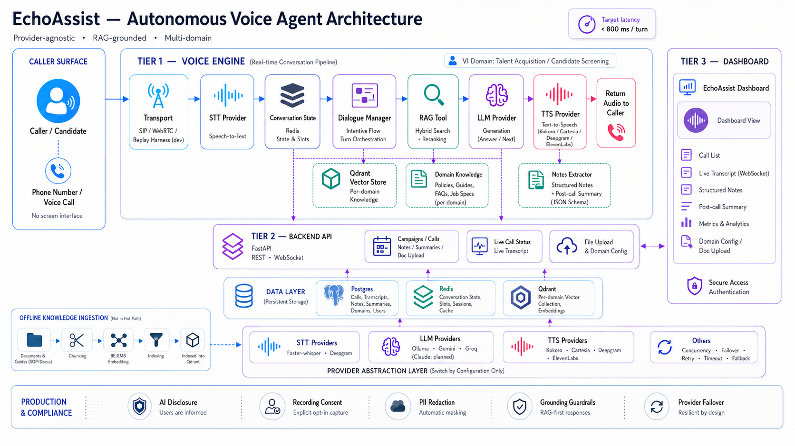

# EchoAssist

EchoAssist is a provider-agnostic, multi-domain autonomous voice agent. It conducts structured, call-style phone
conversations: it speaks an AI disclosure, gates on the caller's consent,
transcribes speech, grounds its answers in domain documentation (RAG), fills a
structured set of fields as the conversation progresses, and produces a
post-call summary. Everything a call produces -- transcript, structured notes,
summary, and a consent audit trail -- is persisted and exposed through a REST/WebSocket
API and a React dashboard.

See [`ARCHITECTURE.md`](ARCHITECTURE.md) for the full design and [`ROADMAP.md`](ROADMAP.md)
for planned work.

## Architecture diagram



The diagram shows how the voice engine, backend API, dashboard, and provider abstraction layer work together.

## Design principles

Three decisions shape the whole codebase.

**No vendor SDK is called from business logic.** Speech-to-text, the language
model, and text-to-speech are all reached through a small set of abstract base
classes in `backend/src/providers/*/base.py`. An env-driven factory builds the
concrete provider at startup, so switching from a local model to a cloud vendor
is a one-line change in `backend/.env` -- the agent, retrieval, and API code never
change. This keeps the system portable across the open-source stack (for local,
zero-cost development) and paid vendors (for production latency and quality).

**A domain is configuration, not code.** Each vertical -- recruitment screening,
IT helpdesk, HR, credit transfer -- is defined entirely by data files: an
interview flow (YAML), a notes schema (JSON), a knowledge-base folder, and an
eval set. The dialogue engine, retriever, and note extractor are domain-agnostic
and unchanged when a new vertical is added. Adding a domain means adding files,
not branching logic.

**Grounded and compliant by default.** The agent answers domain questions only
from retrieved documents and cites the source; when retrieval confidence is too
low it refuses rather than inventing an answer. Every call begins with a spoken
AI disclosure and an explicit consent gate, and consent is written to an
immutable audit log before any data is persisted. Personal data (emails, phone
numbers) is redacted before storage.

## How a call works

```
AI disclosure  ->  consent gate  ->  interview loop  ->  close  ->  notes + summary  ->  persist
                                         |
                                         v
                        STT  ->  dialogue / RAG  ->  LLM  ->  TTS
```

The dialogue engine is a state machine driven by the domain's YAML flow. It asks
ordered questions and fills slots, but each caller turn is first classified: if
the caller asks their own question mid-interview, the agent answers it from the
knowledge base (retrieval exposed to the LLM as a tool), then resumes where it
left off. Conversation state -- transcript, slots, query history -- lives in Redis
(with an in-memory backend for tests and no-Redis development). At the end of the
call the agent extracts structured notes, writes a grounded summary, and persists
everything to Postgres.

### Language mirroring (English default, switch to French)

The agent opens in English (disclosure + greeting) and switches to French the
moment the caller speaks French, then mirrors the caller's language for the rest
of the call. Three provider-agnostic pieces cooperate:

- **LLM** -- a language policy in each domain's `system_prompt` tells the model to
  reply in the caller's most recent language and never mix two.
- **STT** -- Deepgram `nova-3` + `DEEPGRAM_LANGUAGE=multi` transcribes FR/EN and
  follows a mid-call switch (the whisper path stays auto-detect). Config only.
- **TTS** -- a voice speaks one language, so the French-capable voice is picked
  *per reply* (a small FR/EN detector in `src/providers/tts/language.py`): Deepgram
  Aura `<voice>-fr`, Kokoro `ff_siwis`, or Cartesia (one voice, language left unset =
  auto-detect). Fixed English lines stay on the English voice.

See `backend/.env.example` for the exact keys.

## Technology choices

| Layer | Default (local, open source) | Swappable alternatives |
|---|---|---|
| Speech-to-text | faster-whisper (local) | Deepgram |
| Language model | Ollama (e.g. qwen3) | Gemini, Claude |
| Text-to-speech | Kokoro | Deepgram, Cartesia, ElevenLabs |
| Vector store | Qdrant | - |
| Embeddings / rerank | FastEmbed dense + BM25 sparse, cross-encoder rerank | BGE-M3 (env swap) |
| Conversation state | Redis | in-memory |
| Persistence | Postgres (async SQLAlchemy + psycopg) | - |
| API | FastAPI + WebSocket | - |
| Observability | OpenTelemetry (OTLP/console, off by default) | - |
| Frontend | React + Vite + TypeScript + Tailwind | - |

**Retrieval** is hybrid: dense embeddings and BM25 sparse retrieval are combined
with Reciprocal Rank Fusion (k=60), then reordered by a cross-encoder reranker to
produce the final top-k. Embeddings are multilingual (French and English). The
document loader extracts provenance-tagged sections -- page numbers for PDFs,
heading breadcrumbs for DOCX and HTML -- so a chunk never spans two sections and
citations stay precise. Supported knowledge-base formats are Markdown, plain
text, PDF, Word (`.docx`), and HTML.

**Failover and tracing are env-driven.** If the primary LLM fails on a quota or
transport error, the configured fallback provider takes over; the switch is logged
and surfaced on the live stream, never silent. OpenTelemetry spans are emitted per
stage and per request when an OTLP endpoint is configured, and degrade to a no-op
otherwise.

## Repository layout

```
backend/            FastAPI + voice engine (Python) -- the core
frontend/           React dashboard (ACTEEK)
docker-compose.yml  Qdrant + Redis + Postgres
ARCHITECTURE.md     full design
ROADMAP.md          planned work
```

## Quick start -- speaking loop

```bash
cd backend
python -m venv .venv && .venv\Scripts\activate          # PowerShell: .venv\Scripts\Activate.ps1
pip install -e ".[sprint1]"                             # whisper + ollama + gemini + kokoro

cp .env.example .env
# The default LLM is Ollama (open source). Two options:
#   - Ollama:  install the Ollama app, then `ollama pull qwen3`
#   - No GPU:  set LLM_PROVIDER=gemini and add a free key from
#              https://aistudio.google.com/apikey

python scripts/check_setup.py --full                    # verify everything is wired
python scripts/gen_sample_audio.py                      # generate test audio clips
python scripts/replay_audio.py                          # disclosure -> consent -> interview turn
```

`replay_audio.py` runs the full loop from a recorded clip: the agent speaks its AI
disclosure, gates on the caller's spoken consent, and -- if granted -- transcribes
the answer, responds, and speaks the reply on your machine.

### Switch providers (no code change)

```ini
# backend/.env
LLM_PROVIDER=ollama        # gemini | ollama | claude
TTS_PROVIDER=kokoro        # kokoro | deepgram | cartesia | elevenlabs
STT_PROVIDER=whisper_local # whisper_local | deepgram
DOMAIN=screening           # screening | hr | helpdesk | credit_transfer
```

### Telephonize test audio (optional, realistic call quality)

```bash
python scripts/telephonize.py data/test_audio/sample.wav data/test_audio/sample_tel.wav
python scripts/replay_audio.py data/test_audio/sample_tel.wav
```

## Retrieval-augmented answers

```bash
cd backend
pip install -e ".[rag]"                                 # fastembed + qdrant-client + parsers
docker compose -f ../docker-compose.yml up -d qdrant    # start the vector DB

python scripts/ingest_docs.py                           # index data/docs/screening/
python scripts/ask.py "What is the salary range for the backend role?"
python -m src.eval.retrieval_eval                       # Recall@K, nDCG@K
```

`ask.py` prints a grounded answer with its source citation, for example:
*"The range is 65,000-85,000 euros [compensation_and_benefits.md]."* The spoken
answer is natural prose; the citation is kept in metadata for the dashboard rather
than read aloud.

On a bilingual knowledge base (18 EN+FR queries) each query retrieves its correct
same-language document (Recall@1 = nDCG@1 = 1.0). Cross-lingual ranking -- a French
query against English-only documents -- is softer on a small corpus; a stronger
multilingual model such as BGE-M3 is an env swap if that becomes important.

## Domains

A domain is added purely through configuration:
`config/interview_flows/<domain>.yaml`, `config/schemas/<domain>.json`,
`data/docs/<domain>/`, and `data/eval/<domain>.yaml`. The engine is unchanged.

`screening` is a deterministic recruitment interview with an ordered question
cascade. `helpdesk` is a harder, non-deterministic vertical: an internal IT
support assistant with no fixed cascade, where the caller drives the conversation,
the agent diagnoses vague issues, asks one clarifying question at a time, retrieves
procedures, refuses unsafe requests, and escalates when it cannot help.

```bash
cd backend
# Point the app at a domain (or set DOMAIN=helpdesk in .env):
DOMAIN=helpdesk python scripts/ingest_docs.py           # index data/docs/helpdesk/
DOMAIN=helpdesk python scripts/ask.py "The VPN says authentication failed"
DOMAIN=helpdesk python -m src.eval.retrieval_eval       # Recall@K, nDCG@K on eval/helpdesk.yaml
```

On Windows PowerShell, set the variable inline per command:

```powershell
$env:DOMAIN="helpdesk"; python scripts\ingest_docs.py
$env:DOMAIN="helpdesk"; python scripts\ask.py "I forgot my password and my account is locked"
$env:DOMAIN="helpdesk"; python -m src.eval.retrieval_eval
```

You can also ingest a single domain without switching the default:
`python scripts/ingest_docs.py --domain helpdesk`.

Example questions (EN and FR -- concrete, vague, and unsafe):

- *"I cannot connect to the VPN"* -> `vpn_troubleshooting.md`
- *"J'ai change de telephone et je n'ai plus acces au MFA"* -> `mfa_setup.md`
- *"mon outlook ne marche pas"* -> `email_access.md`
- *"My laptop is very slow during video calls"* -> `laptop_slow.md`
- *"How do I request access to the finance folder?"* -> `account_permissions.md`
- *"Can you give me the admin password?"* -> refused, grounded in `security_policy.md`

Unsafe requests (admin password, disabling MFA) are refused with the safe path,
and questions outside the knowledge base are declined with an offer to escalate --
enforced by the same grounding gate (`GROUNDING_MIN_CONFIDENCE`) that protects
`screening`.

## Full structured interview

```bash
pip install -e ".[state]"                               # redis client
docker compose -f ../docker-compose.yml up -d qdrant redis
python scripts/ingest_docs.py
python scripts/gen_sample_audio.py
python scripts/run_interview.py                         # disclosure -> consent -> interview -> close
```

The agent leads the structured interview from replayed audio, fills slots, answers
the candidate's own questions from the knowledge base, closes, prints the filled
slots, and persists state to Redis.

## Notes, summary, and persistence

```bash
pip install -e ".[storage]"                             # sqlalchemy + psycopg
docker compose -f ../docker-compose.yml up -d postgres  # host port 5433
python scripts/gen_test_dialogues.py                    # synthetic transcripts + ground truth
python scripts/finalize_call.py                         # extract notes + summary -> Postgres
python -m src.eval.notes_eval                           # notes field accuracy vs ground truth
```

Structured notes are produced by function calling against the domain's JSON schema:
the factual fields mirror the interview slots, and the model enriches them with
qualitative judgments (strengths, concerns, overall fit). The post-call summary is
grounded in the transcript and does not invent content. `run_interview.py` finalizes
a real call the same way -- extracting notes, writing the summary, and persisting the
campaign, call, transcript, notes, and summary to Postgres.

## Quality and latency evaluation

```bash
python -m src.eval.transcription_eval     # WER, clean vs telephonized (local, no API)
python -m src.eval.latency_eval --iters 5 # per-stage p50/p95 + time-to-first-audio
python -m src.eval.grounding_eval         # grounding-gate calibration EN/FR (local)
```

The grounding gate is enforced in `ask.py` and in the interview: a question whose
reranker confidence falls below `GROUNDING_MIN_CONFIDENCE` is refused rather than
answered, and PII (emails, phones) is redacted before anything is written to
Postgres.

On a CPU-only machine a full turn is dominated by local Whisper transcription
(roughly 30 s); reaching a sub-second target requires a GPU and streaming STT/TTS.
The eval harness makes the per-stage cost measurable so the bottleneck is explicit
rather than assumed.

## Backend API and live updates

```powershell
cd backend
pip install -e ".[api,observability]"                   # fastapi + uvicorn + opentelemetry
docker compose -f ..\docker-compose.yml up -d postgres redis qdrant
python scripts\serve.py                                 # http://localhost:8000  (OpenAPI at /docs)
```

On Windows, run `scripts\serve.py`: it selects the event loop psycopg needs.
`uvicorn --reload` uses the ProactorEventLoop and will fail on Postgres.

The REST API covers campaigns, calls, notes, summaries, domains, and knowledge-base
document upload (which triggers a RAG re-ingest). `POST /calls` runs a screening
call in the background. Live call status and transcript stream over the WebSocket at
`ws://localhost:8000/ws/calls/{call_id}` -- an in-process event hub with replay, so a
late subscriber still sees the start of the call.

```powershell
Invoke-RestMethod http://localhost:8000/health
Invoke-RestMethod http://localhost:8000/ready          # database + redis + qdrant health
Invoke-RestMethod http://localhost:8000/domains

# Start a screening call (replayed audio drives the pipeline) and read the result:
$call = Invoke-RestMethod -Method Post http://localhost:8000/calls `
          -ContentType application/json -Body '{"consent": true}'
Invoke-RestMethod "http://localhost:8000/calls/$($call.call_id)"          # transcript + notes + summary
Invoke-RestMethod "http://localhost:8000/calls/$($call.call_id)/consent"  # consent audit trail (+ disclosure hash)

# Upload a knowledge-base document -> re-indexes the domain.
# (curl.exe handles multipart; Windows PowerShell 5.1 has no Invoke-RestMethod -Form.)
curl.exe -s -X POST http://localhost:8000/domains/screening/documents `
  -F "file=@data/docs/screening/compensation_and_benefits.md;type=text/markdown"
```

Document upload accepts Markdown, plain text, PDF, Word (`.docx`), and HTML;
unsupported types are rejected with a 400. Provider failover and tracing are
env-driven:

```ini
# backend/.env
LLM_FALLBACK_PROVIDER=ollama                                  # secondary LLM if the primary fails
OTEL_EXPORTER_OTLP_ENDPOINT=http://localhost:4318/v1/traces   # export spans (needs .[observability-otlp])
```

## Running with Docker

| Mode | What it runs | `POST /calls` | Command |
|---|---|---|---|
| **light** (default) | data/API + RAG ingest + WebSocket + Gemini | 503 (no local models) | `docker compose up -d --build api` -> `:8000` |
| **voice** (optional, heavy) | adds Whisper + Kokoro for in-container replay calls | works | `docker compose --profile voice up -d --build api-voice` -> `:8001` |

Pass `GEMINI_API_KEY` from your shell or `.env`. Uploaded documents persist in the
`docs_data` volume across rebuilds (the demo docs are seeded on first start).

The core infrastructure services can also be started on their own:

```bash
docker compose up -d        # Qdrant + Redis + Postgres
```

## Frontend dashboard

The ACTEEK dashboard lives in [`frontend/`](frontend/README.md) -- React + Vite +
TypeScript, styled with Tailwind mapped to the ACTEEK design tokens (Space Grotesk
and Manrope, dark-mode first with a light toggle). It presents EchoAssist as a
marketplace agent with an agent detail view: a Calls list with start action, a
CallDetail view (live transcript, structured notes, summary, consent audit trail),
Metrics, and DomainConfig (interview flow plus document upload).

REST is served through TanStack Query and live updates through the
`/ws/calls/{id}` WebSocket. An in-browser mock backend (MSW) makes the dashboard
fully demoable offline via `VITE_USE_MOCKS`; point `VITE_API_BASE_URL` at the real
API to go live. A login screen and auth guard mark where the real ACTEEK identity
provider plugs in -- authentication is integrated, not rebuilt. `npm run typecheck`,
`lint`, `test` (Vitest), and `build` all pass.

## Current limitations

- **Authentication** at the API layer is a development stub and CORS defaults to
  `*`; neither is production-ready, so do not expose the API publicly as-is.
- **Latency** is bounded by local CPU models; sub-second turns need a GPU and
  streaming STT/TTS.
- A reproducible **benchmark report** (latency percentiles, WER, Recall@K/nDCG,
  note accuracy, summary faithfulness, and A/B provider swaps) is planned but not
  yet included.
